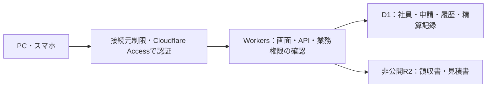

# 経費・購入申請アプリ 簡易設計案

社員約10名の1社専用アプリとして、申請種類に合った承認ルートを設定し、不要な中継を減らす。社内サーバーの管理を不要にし、Cloudflare上で運用する案。以下は設計案であり、現在の公開試作への実装・設定変更は行っていない。

承認記録（2026-11-18）：ユーザーが承認ルートパターンの設計変更を承認。対象は、申請種類へのルート割当、ルート設定画面、経理の事前確認と承認後処理の分離、提出時ルートの保存、保存済みルートに従う再申請、購入済み実績の保持、仮払い支給と後日精算の区別。顧客による運用確認や本書の要確認事項が解消したこと、実装・動作検証・公開が完了したことを意味しない。

## 1. 要件と対象

- ユーザーから伺った要件：出張費・経費精算、備品の購入前申請、社長による承認、経理による精算、PC・スマホ対応。顧客の声の区分は代理情報。
- 2026-11-18の追加要望：申請種類ごとに承認ルートパターンを作成・割当できること。例として、仮払いは「社員→社長→経理」、購入申請は「社員→経理→社長→経理」。従来の全種類共通の固定ルートから変更する。仮払いは今回新たに対象とする。
- 会話で合意した方向：クラウド運用、1社ごとの専用環境、共通プログラムで保守する。日常的なサーバー管理を減らす。
- 社内Wi-Fiからの利用限定という要件は維持する。クラウド化しても自動的に接続元は制限されないため、ログインとは別に設定する。
- 初期対象外：銀行への送金、会計ソフト連携、領収書OCR、金額などの条件による自動分岐・並列承認。順番に処理するルートを対象とする。証憑保存に関する制度対応の充足は別途確認する。

## 2. 構成案

会社ごとにWorker、D1、R2、Access設定を分離する。試験用と本番用も分離し、試験では架空データを使う。DBやR2へブラウザーから直接アクセスさせず、すべての操作をWorker経由にする。

## 3. ログインと役割

Cloudflare Accessを認証の第一候補とする。社員ごとのメールアドレスへ確認コードを送る方式を初期案とし、既存の会社アカウントがあればその認証との連携を検討する。共用メールでは本人を区別できないため、個人ごとの利用可能なメール環境を確認する。

WorkerはAccessの検証済み本人情報とD1の有効ユーザーを照合する。メールヘッダーやブラウザーから渡された役割をそのまま信頼しない。画面・API・添付の全経路を保護し、プレビューURLなどの別経路から認証・接続元制限を迂回できないようにする。

| 役割 | 閲覧・操作できる範囲 |
|---|---|
| 社員 | 自分の申請の作成・閲覧・修正、購入実績登録 |
| 社長 | 承認対象の申請・添付・履歴の閲覧、承認・差し戻し・却下 |
| 経理 | ルートで自分が担当する事前確認または承認後の支給・精算処理、対象の申請・添付・履歴の閲覧と差し戻し |
| ルート設定担当 | ルートパターンの作成・版の公開・申請種類への割当。初期は保守担当に限定し、お客様側への設定権限付与は別途確認 |
| 運用窓口 | 社員の追加・利用停止・役割変更の依頼。日常のサーバー操作は不要 |

社長・経理も社員として申請できるよう、役割は複数保持可能とする。追加・利用停止・役割変更は当初は保守担当が窓口の依頼で行い、変更履歴を残す。自己承認は初期案では認めず、社長本人の申請の代替承認者は要確認。未設定ならその申請の承認を止める。

## 4. 業務フロー

| 種類 | 通常の流れ |
|---|---|
| 出張費・経費精算 | 下書き→社員が明細・領収書を提出→社長承認→経理確認・精算記録→完了 |
| 仮払い申請 | 下書き→社員が用途・予定額を提出→社長承認→経理が仮払い支給を記録→支給済み |
| 備品購入 | 下書き→品目・予定額・理由を提出→経理の事前確認→社長の購入許可→社員が購入・実績と領収書を登録→経理確認・処理記録→完了 |

### 承認ルートパターン

「設定→承認ルート」でパターンを作り、申請種類に割り当てる設計とする。社員は申請種類を選ぶだけで、その種類に割り当てた公開済みルートが自動適用される。社員自身が承認者を減らす・工程を飛ばすルートを選ぶことはできない。

| 設定項目 | 内容・例 |
|---|---|
| パターン名 | 社長直接承認、経理確認あり |
| 対象の申請種類 | 仮払い、購入申請、出張費精算など |
| 工程の順番・名前 | 事前確認→社長承認→承認後処理 |
| 工程の種類 | 内容確認／承認／申請者の実績登録／支給・精算処理 |
| 担当 | 社長・経理などの役割。申請者の実績登録は本人に限定 |
| 公開状態 | 下書き／公開／新規利用停止 |

初期パターン案：

- **社長直接承認**：社員が提出→社長が承認→経理が支給・精算。仮払いに割り当てる。出張費・経費精算も初期案では同じ並びを使うが、仮払いの支給と実費の精算は別の処理として記録する。
- **経理確認あり**：社員が提出→経理が事前確認→社長が承認→経理が承認後処理。購入申請に割り当てる。購入の場合、社長承認後と最後の経理処理の間に「申請者の購入実績登録」を含める。最後の経理が購入前支払も行うかは要確認で、初期案は従来どおり購入後の精算・処理とする。

「経理」が2回出ても別の工程IDで扱う。最初は内容確認、最後は支給・精算であり、事前確認だけで支払や購入許可に進めない。初期のルート検証では、社長の承認工程が少なくとも1つあり、支給・精算はその後にあること、購入の精算前に実績登録があることを確認する。

設定の変更は新しい版として公開し、すでに提出した申請のルートを勝手に変更しない。申請ごとに提出時のルート版・工程順・担当条件を保存する。未割当・担当者不在・自己承認になる場合は自動で工程を省略せず、設定修正または代替承認者の指定まで止める。通常申請からルート設定を書き換えることもできない。

画面には「現在の工程」「次の担当」「全体の進捗」を表示する。同じ経理でも「事前確認待ち」と「精算処理待ち」を分けて表示・集計する。設定公開前に仮払い・購入申請のサンプルで流れをプレビューできるようにする。

例外時の初期案：

- 社長・経理からの差し戻しは理由必須。内容を修正して再提出すると、保存済みルートの最初の確認・承認工程から設定された順番でやり直す。初期パターンの例では「経理確認あり」は経理事前確認→社長承認、「社長直接承認」は社長承認となるが、申請種類だけでこの順番に固定しない。旧版の確認・承認は新しい申請内容に流用しない。
- 購入前に品目・用途・予定額が変わったら、変更内容を再申請し、再承認後に購入する。購入前の中止も理由付きで記録する。
- 購入後の実績額が承認額を超えた場合や品目・用途が変わった場合も、保存済みルートの最初の確認・承認工程から設定順に再実行し、そのルートの承認後処理へ進む。初期の「経理確認あり」パターンなら経理事前確認→社長再承認→経理の購入後処理となる。購入済み・実績登録済みであることを保持し、購入実績登録工程は登録済み実績を引き継ぐ。再購入を求めたり、実績を未登録に戻したりしない。
- 承認済みの内容を直接書き換えない。承認はその時点の申請版に対して記録する。
- 精算完了には金額・処理日・方法・担当者を残す。会社直接購入など社員への返金がない場合も区別する。完了後の訂正は上書きせず、理由を伴う訂正履歴として扱う。
- 仮払いは「支給済み」であって実費の精算完了ではない。後日の経費精算に元の仮払いを紐付け、支給額・実費・追加支給額または返金額を区別し、重複支給を防ぐ。実績提出期限などの運用は要確認とする。

これらの例外処理・自己承認の扱い・支払方法は、お客様による確認前の提案。

## 5. 保存するデータ

| データ | 主な内容 |
|---|---|
| users | 氏名、認証と対応する識別情報、役割、有効・停止 |
| requests | 申請番号、申請者、種類、状態、最新の版、承認済みの版、更新番号 |
| route_patterns / route_versions | パターン名、公開状態、版ごとの工程順・工程ID・担当条件、申請種類との割当 |
| request_routes / request_steps | 申請時点のルート版の写し、工程順、現在の工程、担当条件、担当・実行者、処理日時・結果。繰り返し登場する役割も工程ごとに識別 |
| request_revisions | 件名、用途、日付、複数明細、合計額、購入予定・実績の区別。提出後の版は保持 |
| attachments | 申請版、見積書・領収書の区別、R2の保存先、元の名前・種類・容量 |
| request_events | 誰がいつ何をしたか、理由、対象の版、変更前後の状態。追記で保持 |
| settlements | 対象申請、仮払い支給／実費精算／追加支給／返金の区別、金額、元の仮払い、処理日、方法、担当者、訂正履歴 |

金額は円の整数とし、合計はWorker側で明細から計算する。権限・入力・状態遷移に加え、保存済みルートの現在工程と担当もWorker側で検証する。更新番号で同時操作を検知し、二重承認・二重精算を防ぐ。工程完了・次工程への移動・状態更新・履歴は一体で保存する。

添付は非公開R2に保存し、閲覧時も対象申請への権限を確認する。見積書を購入後の領収書として扱わない。提出済みの添付は別名・別版で保持し、承認時点のファイルを後から差し替えられないようにする。ファイルの形式・容量をサーバー側でも検証し、保存失敗時は申請を完了扱いにしない。

## 6. 画面と運用

画面は現在の一覧・詳細・入力を基礎に、ログイン、下書き、経理の支給・精算記録、承認ルート設定を追加する。本人の役割と担当工程で表示を決め、試作用の自由な役割切り替えは本番から外す。初期の通知は画面内の処理待ち件数とし、メール通知は必要性を確認して追加する。

- D1の復元機能を利用し、復元可能期間は採用プランで確認する。長期保管は定期エクスポートを別途設計する。
- D1とR2は別々に保管されるため、添付も含めたバックアップ・復元手順を用意し、試験用環境で復元を確認する。保存期間とバックアップ先は要確認。
- エラー・利用量・バックアップ失敗を保守担当へ通知する構成を用意する。通知先と担当範囲を決める。
- お客様側の窓口1名は人の追加・退職・問い合わせを連絡し、保守担当が設定変更・障害対応・更新を受け持つ。完全な無保守を約束する設計ではない。
- 社内Wi-Fi限定は会社のインターネット出口IP等で制限する案。固定IP・IPv6・予備回線の有無を確認し、変動する場合は方式を再検討する。スマホのモバイル回線への切り替え時は利用不可とする。

## 7. 実装の順序と確認点

1. 認証・権限・接続元制限とD1の共有保存、ルートパターンと工程管理を組み込み、直接承認と経理確認ありの両方を別端末で通す。
2. R2の添付、申請の版管理、差し戻し・再承認、精算記録を組み込む。
3. バックアップ復元・異常通知・実機操作を確認して、本番へ切り替える。

完成条件：申請種類にルートパターンを割り当てられること、両パターンを別端末で処理できること、2回の経理工程が別扱いになること、工程飛ばし・承認前支給・二重処理を拒否すること、設定変更が提出済み申請へ遡及しないこと、差し戻し後に正しい工程から再開すること。他人の申請や権限外操作の拒否、承認内容・添付の保持、社外回線の拒否、添付を含む復元も確認する。

実装前にまとめて確認する事項は、①各人のログイン用メール、②会社回線の出口IP、③社長本人の申請の承認者、④ルート設定担当と購入前支払・仮払い精算の運用、⑤保守窓口・保存期間・復旧目標・利用プラン。現時点ではCloudflare設定変更・DB作成・本番データ投入は行わない。

## 参考資料

- [D1の概要](https://developers.cloudflare.com/d1/)
- [R2の概要](https://developers.cloudflare.com/r2/)
- [WorkersへのCloudflare Access適用](https://developers.cloudflare.com/workers/configuration/cloudflare-access/)
- [メールのワンタイムコード認証](https://developers.cloudflare.com/cloudflare-one/identity/one-time-pin/)
- [D1のTime Travelと復元](https://developers.cloudflare.com/d1/reference/time-travel/)
